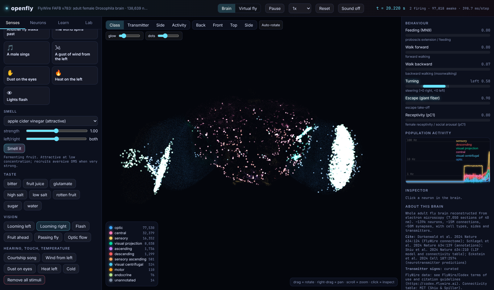
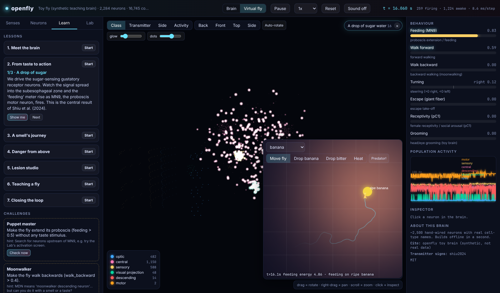
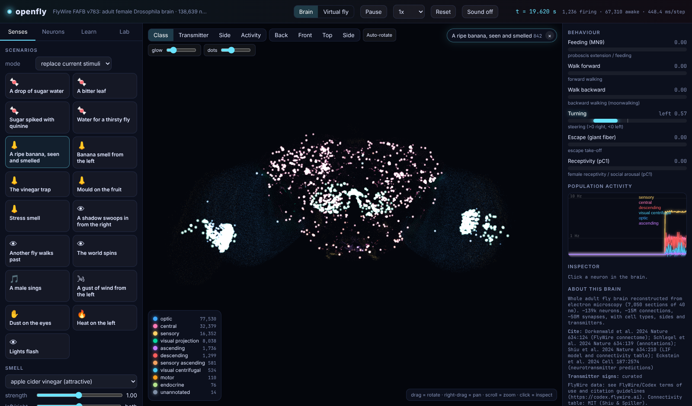

# openfly

**Explore, simulate, visualise and train the fruit fly brain, in Python and in your browser.**

In 2024 the FlyWire consortium published the complete wiring diagram of an
adult fruit fly brain: **139,000 neurons and 50 million synapses**, traced
from ~7,000 electron-microscope slices, each 40 nm thick. openfly turns that
"brain file" (and future ones) into something you can *play with*: make the fly
smell a banana or see a predator, watch every neuron light up in 3D, read
out what it decides to do, silence or activate any cell type, teach it new
associations with dopamine, and put it in a virtual body.



<p align="center"><sub>The real FlyWire brain in the playground. A shadow looms from the right; the right optic lobe and the looming detectors erupt and the giant-fiber escape meter climbs.</sub></p>

## What you can do

| | |
|---|---|
| **Load any connectome** | FlyWire (default), BANC, MANC, male CNS, male optic lobe, hemibrain, any future [Codex](https://codex.flywire.ai) release, or your own tables, as one portable `.flybrain` file |
| **Simulate the whole brain** | the leaky integrate-and-fire model of [Shiu et al. 2024](https://doi.org/10.1038/s41586-024-07763-9), re-implemented as a step-wise, event-driven engine: **r = 0.9996** agreement with the published Brian2 results, ~20x faster, optional numba (another ~3x) |
| **Give it senses** | smell (15 odours plus your own, per antenna), taste (sugar, bitter, water, salt...), vision (spots, images, looming, moving objects, optic flow), hearing (courtship song), wind, touch, heat, humidity, plus 17 ready-made scenarios |
| **Read its behaviour** | feeding (MN9), walking forward/backward, steering, escape, receptivity |
| **Experiment** | silence or activate any neuron set, virtual activation/silencing screens, strongest pathways, influence ("ripple") maps, hubs, brain-to-brain comparisons |
| **Train it** | dopamine-gated mushroom-body plasticity with odour-specific memories, and evolution strategies to tune a circuit for a task |
| **Embody it** | a closed-loop **virtual fly** that smells with two antennae, tastes, sees, forages, refuses bitter food and escapes predators |
| **Play and learn** | a zero-install **web playground** (WebGL, live spikes, lessons, challenges, sonification), standalone 3D "brain movies", 14 docs pages and 9 lessons |
| **Build your own** | `BrainBuilder` sandbox: sketch a circuit, and every tool works on it |

## Quick start

```bash
pip install -e .                 # from this repository (Python >= 3.10)
pip install numba matplotlib     # optional: faster engine, figures

openfly playground               # toy brain, opens your browser (offline)
openfly playground -d flywire_783 --transmitters curated     # the real brain (~140 MB download once)
```

```python
import openfly as of

brain = of.load("flywire_783", transmitters="curated")    # or of.load("toy") for the offline teaching brain
print(brain["MN9"])                                        # <NeuronSet 'MN9': 2 neurons (CB0701 x2)>

sim = brain.simulator()
sim.add(of.senses.taste(brain, "sugar"))                   # the fly tastes sugar...
res = sim.run(500)
print(of.motor.describe(res.behavior()))                   # feeding   ########   0.80  (80 Hz)
res.movie("sugar.html")                                    # ...and you can replay it in 3D
```

More, each a few lines:

```python
sim.add(of.senses.smell(brain, "banana", left=1.0, right=0.3))      # odour from the left
sim.add(of.senses.looming(brain, azimuth=50))                        # predator from the right
sim.silence("CB0553")                                                # virtual lesion
of.analysis.strongest_path(brain, "sugar_GRN", "MN9")                # LB3c -> CB0499 -> CB0465 -> MN9
of.learning.OlfactoryConditioning(brain, reinforcer="reward").run()  # teach it: banana = reward
of.agent.VirtualFly(of.load("toy"), "predator").run(20)              # closed-loop foraging
```

## Command line

```
openfly datasets                           openfly simulate --scenario sugar_drop -d flywire_783
openfly download flywire_783               openfly path sugar_GRN MN9 -d flywire_783
openfly info flywire_783 --types 20        openfly screen MN9 -d flywire_783 --transmitters curated
openfly playground [-d DATASET]            openfly learn --reinforcer punishment
openfly fly --arena bitter_trap --plot fly.png      openfly scenarios | odors | tastes | lessons
```

## Selected results (all reproducible with this repo)

* **Validation:** re-running the reference experiment of the paper (sugar
  neurons at 200 Hz) gives per-neuron firing-rate correlation **0.9996** with the
  published Brian2 output. Getting there required reproducing a subtle Brian2
  rule: input arriving during refractoriness is lost ([details](docs/13-validation.md)).
* **Feeding:** on FlyWire, MN9 has a sharp threshold (silent below 25 Hz of
  sugar-neuron input, 31 Hz at 50, saturating near 80 Hz), and bitter vetoes it completely.
* **A testable prediction:** an in-silico screen ranks **CB0553** as the
  strongest driver of MN9, and silencing it cuts sugar-evoked MN9 firing from
  ~80 to ~4 Hz.
* **Smell needs corrected signs:** with the published transmitter predictions any odour
  sets off a runaway loop in the antennal lobe. Re-signing ~130 local neurons
  that are GABAergic in real flies gives a sparse Kenyon-cell code (~3.5% active) ([details](docs/05-simulation.md#transmitter-policies-when-predictions-go-wrong)).
* **Learning on the real connectome:** dopamine-gated plasticity makes banana
  attractive (+0.27) or aversive (-0.21) depending on the reinforcer, without
  affecting an unpaired odour ([details](docs/10-training-the-brain.md)).
* **Closed loop:** the toy-brain virtual fly found and ate the banana in 6/6
  runs, escaped 6/6 predator attacks, and approached a bitter-spiked bait every
  time but never ate it. On FlyWire, odour-guided walking does not yet emerge
  ([why](docs/09-virtual-fly.md#on-the-real-flywire-brain)).

See [Findings and limitations](docs/14-findings-and-limitations.md) before drawing biological conclusions.

## Documentation

Start at **[docs/README.md](docs/README.md)**: the connectome and how it was
made, architecture, data and brain files, the brain API, simulation,
senses, behaviour, playground, virtual fly, training, analysis, adding new
brains, validation, findings. Hands-on [lessons](docs/lessons/) and
runnable [examples](examples/).

<table><tr>
<td></td>
<td></td>
</tr><tr>
<td align="center"><sub>The virtual fly (toy brain) found the banana and feeds</sub></td>
<td align="center"><sub>FlyWire: a ripe banana, smelled and seen</sub></td>
</tr></table>

## Project layout

```
openfly/
  data/        datasets, downloader, .flybrain format, FlyWire / Codex / neuPrint adapters, BrainBuilder, toy brain
  brain.py     Brain (neurons + signed sparse W)          neurons.py   NeuronSet
  knowledge.py curated neuron names                       transmitters.py  sign policies
  sim/         LIF engines (NumPy, numba), Simulator, SimResult, RateModel
  senses/      smell, taste, vision, mechano, thermo, scenarios
  motor.py     behaviour readout                          analysis/    graph tools, comparisons
  learning/    mushroom-body plasticity, evolution strategies, screens
  agent/       VirtualFly, Arena                          viz/         plots, HTML brain movies
  playground/  web server, live session, lessons, static/ (HTML/CSS/JS, WebGL2)
  cli.py
docs/  examples/  tests/
```

## Testing

```bash
pytest                                        # 63 tests, ~15 s, offline (toy brain + synthetic files)
OPENFLY_TEST_FLYWIRE=1 pytest tests/test_flywire.py      # checks on the real connectome
python examples/validate_against_brian2.py               # reproduce the validation (needs brian2)
```

## Data, licences and citation

openfly's code is MIT-licensed. Connectome data is **downloaded from its
publishers and stays under their terms**; please cite the original work.
See [CITATION.md](CITATION.md): FlyWire (Dorkenwald et al. 2024; Schlegel et
al. 2024), the model (Shiu et al. 2024), neurotransmitter predictions
(Eckstein et al. 2024), and the other connectomes you load.
